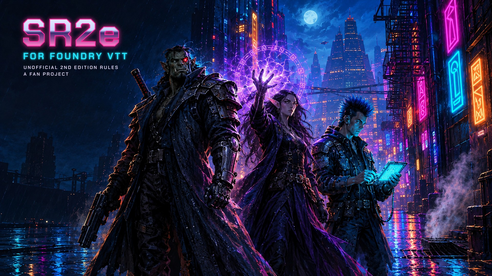
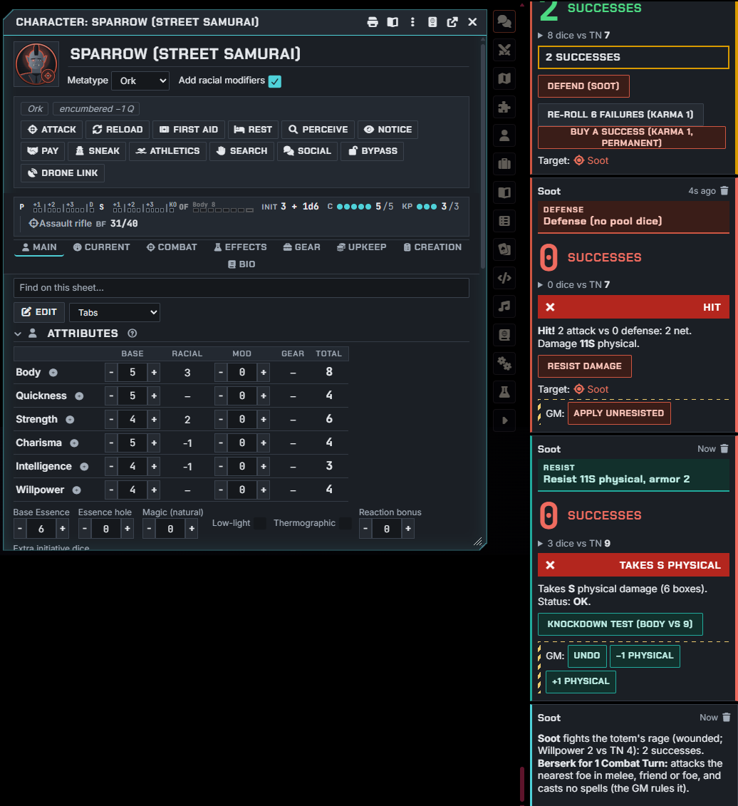
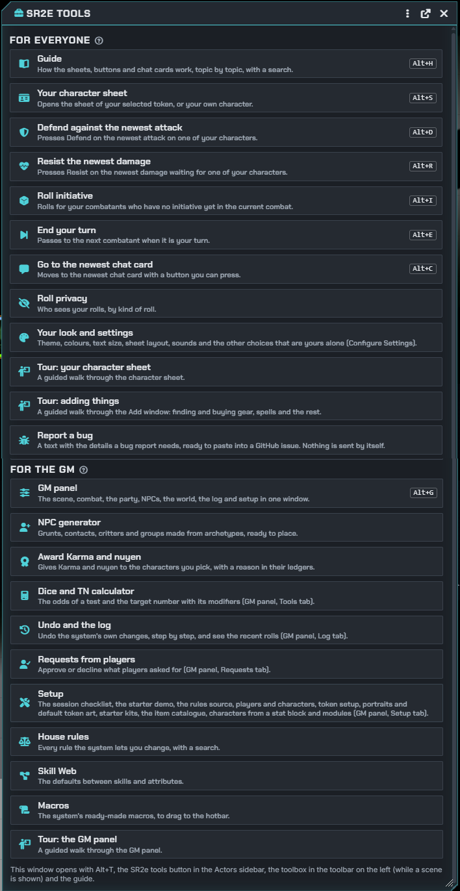

# Shadowrun 2nd Edition (Unofficial) for Foundry VTT



An unofficial game system for **Foundry Virtual Tabletop v14** that plays **Shadowrun, Second Edition**: target-number success tests with the Rule of Six and Rule of One, dice pools, initiative passes, damage staging and the condition monitor, with magic, the Matrix, rigging and building security on top.

**You need your own copy of the Shadowrun Second Edition rulebook.** The system automates the rules; it contains no rulebook text, art or compendia of book content (the only compendium is a set of helper macros; see "Licence and credits").

**Made with AI:** this system was written by an AI (Anthropic's Claude) under human direction. See "Built with AI" below.

## Install

You need **Foundry VTT version 14** (older versions won't load it) and your own copy of the Shadowrun Second Edition rulebook.

1. Start Foundry and, on the setup screen, open the **Game Systems** tab.
2. Click **Install System**. At the bottom of the window, paste this into the **Manifest URL** box and click **Install**:
   ```
   https://github.com/SpaceisbigSoft/foundry-sr2e/releases/latest/download/system.json
   ```
3. Open the **Game Worlds** tab, click **Create World**, and choose **Shadowrun 2nd Edition (Unofficial)** as the game system.
4. Launch the world and log in as the Gamemaster.

**First steps in the world:**
- Press **Alt+T** (or the **SR2e tools** button in the Actors sidebar) to see every tool the system has.
- To try it out before making your own characters, open the **GM panel** from there, go to its **Setup** tab and click **Create the demo**. It makes four ready-made runners, a scene and a journal, *SR2e demo: try this*, that walks you through a fight, a spell, the Matrix and more. **Remove the demo** takes it all out again.
- The **Guide** button on every sheet, or **Alt+H**, opens the in-game player guide.

**Updating:** when there is a new version, Foundry shows an **Update** button next to the system in the **Game Systems** tab. After updating, fully quit and restart Foundry if something looks missing (some changes are only read when Foundry starts).

**Installing by hand instead:** download `sr2e.zip` from the [Releases page](https://github.com/SpaceisbigSoft/foundry-sr2e/releases), make a folder named `sr2e` inside your Foundry `Data/systems` folder, and unzip the file into it, so that `Data/systems/sr2e/system.json` exists. (Foundry's setup screen shows where your Data folder is under **Configuration → User Data Path**.) Then restart Foundry.

**Found a problem?** Please report it on the [issue tracker](https://github.com/SpaceisbigSoft/foundry-sr2e/issues). The **Report a bug** button in the in-game guide collects the details (versions, modules, settings) for you to paste in; nothing is sent automatically.

## Screenshots

| Playing | Every tool in one place |
|---|---|
|  |  |

The pictures show the starter demo (GM panel, Setup, Create the demo).

## Built with AI

**This system was built with AI.** Its code, tests and documentation, including this README and the in-game player guide, were written by Anthropic's Claude, an AI model, working under the direction of the project's human owner, Spaceisbig ([GitHub](https://github.com/SpaceisbigSoft)). The owner chose what to build, made the design and rules decisions, and reviewed the results. Claude wrote the code, ran the automated tests, deployed builds to a test world and played through them in Foundry as a GM and a player. Independent AI reviews checked each version before release. The cover painting was made by the owner with another AI, OpenAI's ChatGPT image generation, from a brief Claude wrote; Claude added the title.

That has two consequences you should know about:

- **The rules numbers came from the AI's memory of the books**, not from a human typing them out of a rulebook, so some were wrong. In v0.92.3 the AI checked the default rules against the SR2 books and corrected them; a human has not re-checked that work, so every number is listed with its source in `docs/VERIFY.md` for checking against your book.
- **No human has play-tested it at a table yet.** Expect bugs, and please report them.

## Status: v0.92.5 (release)

The system is feature-complete for SR2 core play and much of the sourcebook material, and v0.92.5 is its first release (earlier GitHub builds were test builds). It is tested by 4,104 automated tests, by in-Foundry test batches (Quench), by live runs in Foundry v14 as a GM and a player, and by an upgrade test from worlds saved with v0.50 and v0.72, and v0.81 had a full code and security review. It has not yet been play-tested at a real table, so expect rough edges. In v0.92.3 the default rules were checked against the SR2 books and made to follow them; `docs/VERIFY.md` lists every rules number with its source (and what is still unchecked), and every rules change since v0.70.0 has a house-rule switch that puts the earlier behaviour back.

What changed in each version: `CHANGELOG.md`.

## What it does

- **Tests and pools:** success tests with automatic target-number modifiers (wounds, light, smoke, range, cover, movement, background count and more, each one switchable in the roll dialog), Combat, Spell, Hacking, Control and Karma Pools, Karma re-rolls and Avoid disaster on roll cards, open, complementary and teamwork tests.
- **Combat:** firing modes, recoil, ranged and melee attacks with Defend and Resist buttons, counterattacks, called shots, full defense, blasts with scatter on the canvas, grenades, demolitions, armor layering, holds, Take Aim, delaying, and an SR2 combat tracker with initiative passes.
- **Health:** physical and stun monitors with overflow, dying and stabilising, healing, toxins, drugs and addiction, disease, fire, falling and the environment, DocWagon contracts.
- **Magic:** spellcasting and drain, conjuring and spirits, the astral plane, initiation and metamagic, foci, adepts, wards, rituals, enchanting, signatures, critters and their powers.
- **Matrix and rigging:** cyberdecks and programs, hosts with security tallies and IC, cybercombat, the grid; vehicles, jumping in, drones, chases, vehicle combat; security sites with devices, alerts and response.
- **Characters:** a step-by-step creation wizard, Karma advancement with an optional GM approval queue, contacts, lifestyle and upkeep, things that take time (training, orders, repairs).
- **The shop:** the Add window is where characters buy things: prices with the Street Index, Availability and legality on every row; out of creation a character finds an item first (the Availability test), then buys or haggles on the card, and it arrives after the time it took. The GM chooses what players see (everything, their own catalogue, or what they mark "in the shop"), and sees the open orders. A **Shop** button (the tools window, the left toolbar, the character sheet's title bar) opens it; **New entry…** adds something the catalogue lacks, typed from your own book (a player's goes to the GM to check). Check boxes sort each tab by category (pistols, SMGs, rifles…).
- **Vehicles and drones in the shop:** found and bought like gear; each arrives as a vehicle of your own, listed on the Rigging tab.
- **Rules interpretations (†):** where the rules as written leave something unclear, a small † marks the creator's reading; click it for what is unclear, how it is resolved, the sources and the house rule that changes it (all listed in one window).
- **The layered Magic Pool:** Sorcery's concentration and specialization add Spell Pool dice usable only inside them, and a spell inside them rolls their rating.
- **Spell formulas and teachers:** out of creation a new spell is learned from a formula (found and bought like gear, for one tradition), a teacher who knows it (their Instruction test adds dice to the learning test), the group's grimoire or the magician's own design.
- **The Catalogue:** a book of everything you can get, with a page per entry (price, stats, description), linked from every shop row; players see what their shop shows.
- **For the GM:** a GM panel (scene, combat, party, NPCs, world, tools, log, requests, setup), an NPC generator, an undo log for the system's changes, house rules in a searchable window, starter kits and an item catalogue you fill from your own data (pasted spreadsheet rows, or one catalogue file with items, vehicles, NPCs, critters and spirits that also fills in the missing numbers of matching items already in the world).
- **Rules source:** the book rules are the default. The GM can switch the world to the **SR2E Unified Rules Revamp**, an optional set of revamped rules (a community revamp of the SR1–3 rules plus house rules), and back. The GM's own house rules win over either.
- **At the table:** `@SR2Test[...]` roll links in journals and the `/sr2` chat command, an **SR2e Macros** compendium of ready macros (tests, attacks, spells, defense, initiative, and a few for the GM), and built-in support for Token Action HUD Core, Item Piles and Health Estimate, and Monk's Enhanced Journal in one dark look with Foundry's dark scheme.
- **Scene builder:** a step-by-step window for the GM that builds a whole scene: a map (one of the system's own backdrops with matching walls, doors and lamps, or your own picture), time of day and weather, background count and wards, the player characters and NPCs (your actors or made by the NPC generator) in their start areas, a security site and its Matrix host, a GM journal, music and the combat tracker. It also changes an existing scene, saves set-ups as templates, and removes what it made.
- **Default token art:** the system's own pictures and tokens (AI-drawn vector art): people by metatype and figure with an archetype badge, critters, spirits, vehicles and drones, IC, hosts and more, with a rim coloured by area (the same colours as the sheets, chosen to stay apart with colour blindness), picked by themselves and following the actor's changes until you set a picture of your own.
- **Look and feel:** per-player themes, colour presets and text size, sheet layouts, a status strip, colourblind-safe dice, an in-game player guide (the **Guide** button in every sheet's title bar, and the **?** beside each heading; also `docs/PLAYER-GUIDE.md`).

## Security

Treat players as untrusted: anyone can change what their own browser sends. The system is built for that.

- **Chat cards are checked.** A card's buttons check who really posted it, and treat its text and data as input to check, not as fact. A routine test that another player's card forces on your character (Defend, Resist) goes ahead; anything costly or lasting asks you first (*A card from another player*); a card that doesn't say which character it comes from does nothing.
- **The GM confirms what players can't change.** A player's test that changes something they don't own posts an **Apply (GM)** card. Its confirm is built from the card's data and names who posted it, so read it before saying yes. Applying such changes by themselves is off by default. With the approval queue on, **Approve** also shows what will really run first.
- **Some limits are table rules a player could skip.** The approval queue and the lock on raising ratings after creation run in the player's browser, so a player who knows how can get past them. The GM panel's Requests tab, the advancement log and the undo log show what was done.
- **Players can see more than the screen shows.** Foundry sends every chat message and every actor to every player's browser, so whispers, blind rolls and hidden NPC sheets are hidden in the interface only.

## Develop

1. `npm install`
2. `npm test` runs the rules-engine and Foundry-glue tests (Node 22+; uses tsx and node:test).
3. `npx tsc --noEmit` type-checks.
4. `npm run build` compiles `src/start.ts` to `public/index.mjs`.
5. To try your build, copy the contents of the `public` folder into `Data/systems/sr2e`.
6. **In-Foundry tests:** with the [Quench](https://github.com/Ethaks/FVTT-Quench) module active, a GM can run the system's test batches from Quench's window (or `quench.runBatches('sr2e.**')` in the console): every document type and sheet, tests and chat cards, combat, the record sheet's tweaks and accessories, the translation and the world's migrations. **SR2e: performance on a busy table** is opt-in: it builds a temporary scene with 50 tokens, a long combat and 300 chat cards and prints timings. Run them in a test world: each batch makes `ZZ Quench …` documents and removes them afterwards. Keep Quench's window open while they run.
7. `npm run tokens` redraws the default token art from `src/art/` into `public/tokens/`, and `npm run backdrops` the scene backdrops into `public/backdrops/` (only needed after changing a drawing; the files are committed).

The rules engine (`src/module/rules`) is pure TypeScript with no Foundry dependency; its numbers live in `src/module/rules/config.ts`, marked `VERIFY`, so they are easy to check and to change as house rules. The Foundry glue is in `src/module/documents`, `models` and `applications`. Module authors: see `docs/API.md` (`game.sr2e.api` and hooks).

## Licence and credits

Licensed under **CC BY-SA 4.0**; see `LICENSE.md` for the full notice. sr2e started from the project setup of [SRA2](https://github.com/VincentVk9373/sra2), the community Shadowrun Anarchy 2 system by the Anarchy development team (Half, Vincent VK, Los Brutos, Cefyl, Dirt, Romano, Carmody, Asimov). Only that setup (the build configuration and folder layout) came from SRA2; all of the game code, sheets, art and text were written for sr2e, and no SRA2 game content is included. The bundled fonts (Chakra Petch, JetBrains Mono, Inter) are under the SIL Open Font License 1.1. The default token art in `tokens/` and the scene backdrops in `backdrops/` are the system's own, drawn by the AI for it, under CC BY-SA 4.0 like the rest, and so is the cover picture (painted with ChatGPT image generation from Claude's brief, title by Claude).

This is an unofficial fan project, not affiliated with or endorsed by The Topps Company, Catalyst Game Labs or Black Book Editions. Shadowrun and Matrix are registered trademarks and/or trademarks of The Topps Company, Inc. in the United States and/or other countries. The system contains no rulebook text or art; the game numbers it needs to run the mechanics (rule constants, starter item templates, a totem modifier table) are listed in `docs/VERIFY.md`.
